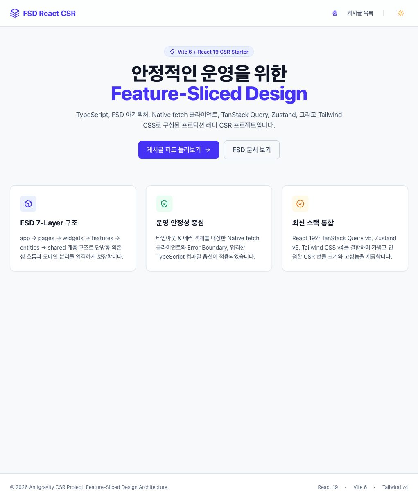
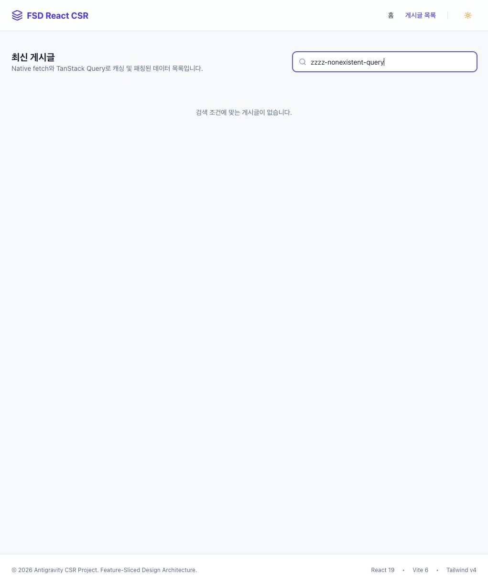
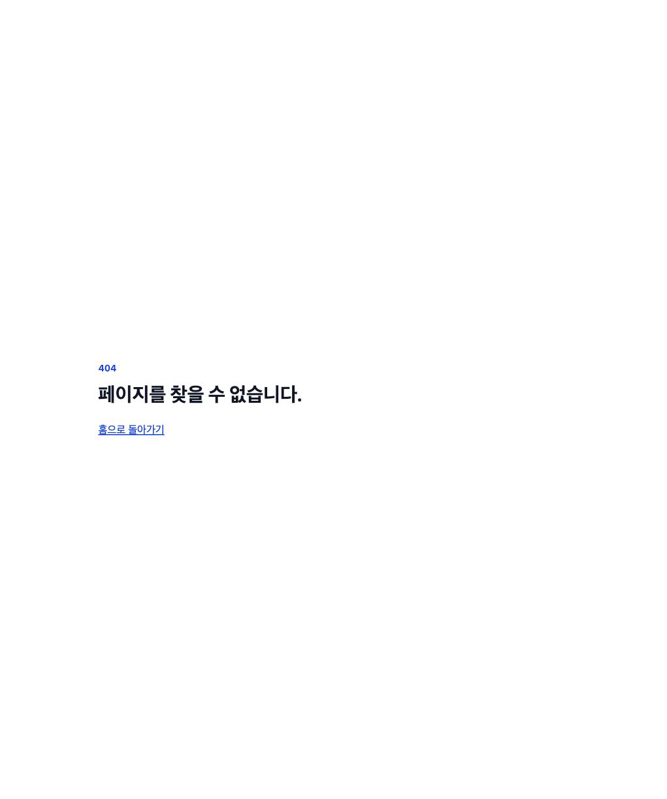

# React Boilerplate 비교 분석

분석 기준일: 2026-10-31, Asia/Seoul

이 문서는 최초 분석의 관측과 이후 보완을 함께 기록한다. 공개 준비에서 루트·개별 프로젝트의 .gitignore를 보완했으므로, 아래 환경변수 제외 규칙의 부재는 **최초 분석 당시의 상태**다. 앱 소스와 의존성 선언은 수정하지 않았다. Router 선택의 의미는 사용자 지적 후 [공식 변천사 조사](docs/react-router-history.md)로 보완했다. 원본 요청과 결과물의 관계는 사용자 설명에 근거하며 생성 대화 전체를 독립적으로 검증한 것은 아니다.

**판단:** 실무 확장을 위한 도구와 예제의 균형은 Cursor가 가장 좋다. 최소 프로젝트 골격과 범위 절제는 Codex가 좋다. Antigravity는 UI·기능 예제가 가장 풍부하지만, 추가한 공통 인프라와 기능에서 재현되는 결함이 있어 운영 안정성 점수를 낮게 평가한다. 이는 이번 세 결과물에 대한 판단이며, 도구 자체의 일반적인 성능 순위를 뜻하지 않는다.

**원본 요청**

> vite를 사용하여 csr 개발을 위한 react 프로젝트를 만들어 줘.
> 운영 안정성을 위한 최신 lts 버전들을 검토하고, FSD 기반으로 디렉토리 구조를 만들어줘.
> 언어는 ts로 하고 기타 결정이 필요한 부분은 문의 줘.

생성 당시 대화·승인 기록은 제공되지 않았다. 추가 기술 선택을 사전에 문의했는지는 판정할 수 없다. Router, TanStack Query, Tailwind는 세 프로젝트 모두에 들어 있으며 Antigravity에는 Zustand, 아이콘, CSS 유틸리티도 추가되어 있다. 이들은 Vite·React·TS·FSD만으로 자동 결정되는 항목은 아니다.

**요구사항과 구현 비교**

| 항목 | Antigravity | Cursor | Codex |
| --- | --- | --- | --- |
| Vite 기반 React CSR | 구현, 빌드 통과 | 구현, 빌드 통과 | 구현, 빌드 통과 |
| TypeScript | strict, noUncheckedIndexedAccess | strict, verbatimModuleSyntax 등 | strict, verbatimModuleSyntax 등 |
| Node 선택 | .nvmrc·engines 없음 | .nvmrc 26, engines >=26.13.0 | .nvmrc 24.22.2, engines >=24 <25 |
| LTS 선택 근거 | Node 선택 근거 없음 | 최신 LTS 선택, 설명은 짧음 | 26의 LTS 전환 직후라는 점을 고려해 24 선택 근거 문서화 |
| FSD 적용 | 6개 레이어에 실제 구현, widgets 간 cross-import 존재 | 실제 페이지·feature·entity 연결, 조사한 import에서 레이어 위반 없음 | app/pages 구현, 나머지 레이어는 README로 역할만 안내 |
| FSD 자동 강제 | 없음 | 없음 | 없음 |
| 라우팅 | 홈·게시글·404 | 홈·소개, 미일치 경로 빈 화면 | 홈·404 |
| API 예제 | 게시글 12개, 로컬 검색 | 게시글 3개 | 없음 |
| 데이터 상태 처리 | 로딩·오류·검색 결과 없음 | 로딩·오류, 빈 목록 메시지 없음 | 적용할 API 기능 없음 |
| 렌더링 ErrorBoundary | 본문 Outlet 주변에 있음 | 없음 | 없음 |
| 테마 | 토글 상태·아이콘만 변경, 배경·문자 색상 미변경 | 없음 | 없음 |
| 검사 도구 | build 내 타입 검사 | typecheck, oxlint(typeAware), oxfmt, Vitest | build 내 타입 검사, oxlint |
| 문서 | 구조·예제 설명 상세, 안정성에 관한 과한 표현 있음 | 실행 명령 중심, 매우 짧음 | Node 선정, FSD 규칙, SPA 배포 주의사항 설명 |

Codex의 빈 레이어를 FSD 위반이라고 보지는 않는다. FSD 공식 문서는 모든 레이어를 사용할 필요가 없다고 안내한다. 다만 실제 도메인을 추가할 때의 구조와 의존성 관리는 아직 검증할 사례가 없다.

**실제 설치 버전**

package.json의 최소 범위만 비교하지 않고 node_modules에 실제 설치된 버전을 확인했다. 예를 들어 Antigravity가 React ^19.0.0을 선언해도 실제 설치 버전은 다른 두 프로젝트와 같다.

| 항목 | Antigravity | Cursor | Codex |
| --- | --- | --- | --- |
| React | 19.3.1 | 19.3.1 | 19.3.1 |
| Vite | 6.4.5 | 8.3.5 | 8.3.5 |
| TypeScript | 5.9.3 | 7.0.2 | 7.0.2 |
| Tailwind | 4.3.3 | 4.3.3 | 4.3.3 |
| TanStack Query | 5.105.0 | 5.105.0 | 5.105.0 |
| Router | react-router-dom 7.18.5 | react-router 8.5.1 | react-router-dom 7.18.5 |
| @types/node | 22.20.5 | 26.6.6 | 24.19.2 |

@types/node는 타입 정의이며 실제 실행 Node 버전을 지정하지 않는다. Antigravity를 Node 22 프로젝트로 단정할 수 없다.

Router 차이는 단순한 버전 취향으로만 보기 어렵다. v7의 react-router-dom은 패키지 통합 후 호환을 위한 재수출이며 v8에서는 제거되었다. Antigravity와 Codex는 동작하는 v7 호환 패키지를 사용하지만, 신규 프로젝트의 최신 구성을 검토하는 요청에서 이 진입점을 택한 근거가 없다. 현재 런타임 오류나 실제 major 혼용을 확인한 것은 아니다. [공식 v8 이전 안내](https://reactrouter.com/upgrading/v7#react-router-dom)와 [상세 연혁·로컬 대조](docs/react-router-history.md)를 참고한다. 처음 분석에서는 이 의미를 충분히 평가하지 못했으며 보완 후에는 Codex의 최소 골격·문서 장점과 별도로 중요한 선택 누락으로 평가한다.

Node 26.13.0은 2026-10-28에 LTS로 전환되었다. 따라서 ‘최신 LTS’라는 문구에 가장 직접적으로 부합하는 선택은 Cursor다. Codex의 Node 24도 지원되는 LTS이며 보수적인 선택의 근거는 적었으나 최신 LTS 자체를 선택한 것은 아니다. Node 24 선택을 사용자에게 확인했는지는 알 수 없다. [Node 26 LTS 발표](https://nodejs.org/en/blog/release/v26.13.0), [Node 릴리스 상태](https://nodejs.org/en/about/previous-releases).

Vite는 현재 8.3에 일반 패치를, 6.4에는 보안 패치를 제공한다. Antigravity의 Vite 6.4.5를 ‘지원 종료’나 ‘취약’이라고 단정하지 않는다. 다만 신규 프로젝트에서 보안 패치만 받는 구간을 선택할 근거와 업그레이드 계획이 문서에 없다. [Vite 공식 지원 정책](https://vite.dev/releases).

**검증 결과와 비교 수치**

| 직접 실행한 검사 | Antigravity | Cursor | Codex |
| --- | --- | --- | --- |
| pnpm build (tsc -b 포함) | 통과 | 통과 | 통과 |
| 프로젝트의 oxlint 실행 | 미구성 | 통과 | 통과 |
| oxfmt --check | 미구성 | 통과, 기본 설정 사용 | 미구성 |
| 기존 Vitest 테스트 | 미구성 | 2개 파일, 4개 테스트 통과 | 미구성 |
| 브라우저 홈 화면 | 정상 표시 | 정상 표시, 게시글 3개 수신 | 정상 표시 |
| 브라우저 미일치 경로 | 404 표시 | 빈 화면 재현 | 404 표시 |
| 추가 브라우저 확인 | 게시글 12개 수신, 검색 결과 없음 표시, 테마 문제 재현 | 목록 표시 확인 | 404 복귀 링크 표시 확인 |

| 규모 | Antigravity | Cursor | Codex |
| --- | ---: | ---: | ---: |
| src의 TS/TSX/CSS 파일 수 | 47 | 31 | 8 |
| 위 파일의 줄 수 | 795 | 277 | 69 |
| 직접 production 의존성 | 8 | 4 | 4 |
| 직접 dev 의존성 | 9 | 16 | 9 |
| 빌드 JS 원본 크기 | 408.72 kB | 291.95 kB | 283.37 kB |
| 빌드 JS gzip 크기 | 128.80 kB | 91.94 kB | 89.25 kB |
| 빌드 CSS gzip 크기 | 4.93 kB | 2.82 kB | 2.25 kB |

파일·줄 수는 index.ts, 타입 파일, 테스트와 CSS를 포함하며 README와 이미지·SVG는 제외했다. 번들은 서로 다른 기능·Router 버전·빌드 도구를 사용한 현재 결과물의 수치다. 이 값으로 생성 도구의 최적화 능력이나 실제 사용자 성능을 직접 순위 매길 수 없다. 세 프로젝트 모두 현재 빌드는 JS 단일 청크이며 라우트 지연 로딩은 없다. 현재 규모에서 반드시 결함인 것은 아니다.

검사 환경은 macOS arm64, Node 24.21.0, pnpm 12.6.0이다. Cursor가 요구하는 Node 26.13.0 및 Codex의 .nvmrc가 지정하는 24.22.2에서 재검증한 결과는 아니다. 새 환경에서의 clean install, CI, 실제 호스팅 배포·복구, 모바일·키보드·스크린리더 전수 검증과 취약점 감사는 수행하지 않았다.

**Antigravity: 기능은 풍부하지만 공통 코드의 신뢰성이 부족**

장점은 API, 캐시, 검색, 카드 UI, ErrorBoundary 등 FSD를 이해할 구체적인 예제가 있다는 것이다. 환경변수 예제와 엄격한 인덱스 접근 검사도 있다. 반면 다음은 구현 또는 동작에서 확인한 문제다.

1. **텍스트 HTTP 오류를 처리하다 원래 HTTP 상태를 잃는다.** `src/shared/api/client.ts:51`부터 response.json() 실패 후 같은 body를 response.text()로 다시 읽는다. 실제 Response 객체에 텍스트 본문과 503을 설정해 실행하면 ApiError 대신 `TypeError: Body is unusable: Body has already been read`가 발생한다. 프록시·서버의 텍스트/HTML 오류 응답에서 공통 오류 정책이 깨진다.
2. **호출자의 취소 신호가 무시된다.** `client.ts:44`에서 options.signal을 새 controller.signal로 덮어쓴다. 이미 abort된 signal을 넘겨도 fetch에 전달된 signal은 abort되지 않았다. 별도로 `entities/post/model/queries.ts:16`의 queryFn도 TanStack Query의 signal을 받지 않는다. 타임아웃은 있지만 쿼리 취소 전달은 구현되지 않았다.
3. **유효한 JSON 본문이 누락될 수 있다.** `client.ts:84`, `90`, `96`은 body의 truthiness로 직렬화 여부를 결정한다. POST false를 실행하면 body가 undefined가 된다. 0과 빈 문자열에도 같은 조건이 적용된다. 현재 게시글 GET 예제에는 영향을 주지 않지만 재사용 HTTP 래퍼의 결함이다.
4. **테마가 시각적으로 적용되지 않는다.** `features/theme/model/useThemeStore.ts:14`는 html.dark를 붙이고 아이콘도 변경한다. 하지만 CSS·UI에 이에 대응하는 다크 테마 색상 규칙이 없다. 브라우저에서 클릭 전후 루트 배경은 동일한 `oklch(0.984 0.003 247.858)`이었다. 저장·시스템 테마 연동도 없다.
5. **FSD 같은 레이어의 slice 간 의존이 있다.** `widgets/layout/ui/RootLayout.tsx:3`과 `:4`가 `widgets/header`, `widgets/footer`를 import한다. 공식 FSD의 하위 레이어 참조 규칙에 어긋난다. 전체 레이아웃 조합을 app으로 옮기는 것이 한 가지 해결책이다. [FSD 레이어 규칙](https://feature-sliced.design/docs/reference/layers).
6. **예제 마감 품질을 더 다듬어야 한다.** 검색 인풋에 명시적인 label/aria-label이 없고, HomePage와 404에서 링크 안에 button을 넣는다. index.html은 존재하지 않는 `/vite.svg`를 참조한다. ErrorBoundary는 Outlet 본문만 감싸므로 헤더·푸터까지 보호하는 전역 경계는 아니다.

‘프로덕션 레디’, ‘단방향 의존성 엄격 보장’이라는 화면 설명은 위 검증 결과보다 강하다. 예제 자체는 유용하지만 공통 HTTP 클라이언트와 테마를 신뢰할 수 있는 기본값으로 바로 복제하기에는 보완이 필요하다.

**Cursor: 개발 도구와 실제 예제의 균형이 가장 좋음**

장점은 환경 선언, 타입 검사, 타입을 활용하는 lint 설정, formatter, 테스트 실행 기반을 함께 제공한다는 것이다. `entities/post`에 API·타입·쿼리 옵션을 두고 `features/post-list`에서 소비하는 흐름도 짧아 읽기 쉽다. QueryClient를 provider 생명주기에 맞춰 한 번 만들고 기본 staleTime과 retry를 명시한다.

우선 보완할 사항은 다음과 같다.

1. **404 경로 부재:** `src/app/routes/AppRouter.tsx:10`의 Routes에 `*`가 없다. `/missing-route` 직접 접근 시 빈 화면을 브라우저에서 재현했다.
2. **HTTP 래퍼의 지원 범위가 JSON 응답에 한정:** `src/shared/api/http.ts:8`은 모든 성공 응답에 json()을 호출한다. 실제 204 Response를 주면 `SyntaxError: Unexpected end of JSON input`이 발생했다. 현재 게시글 GET은 정상이나 범용 클라이언트로 확대하려면 응답 유형 계약을 정해야 한다.
3. **취소·타임아웃 정책 부재:** http 자체는 RequestInit을 전달하지만 `entities/post/api/post-api.ts:5`의 fetchPosts는 Query signal을 받지 않는다. 요청 타임아웃도 없다.
4. **테스트가 보장하는 범위가 좁음:** 기존 4개 테스트는 HTTP 성공/실패 각 1개, formatError 2개다. 라우팅·UI·취소·타임아웃·204·잘못된 JSON·응답 형태는 다루지 않는다. Testing Library와 user-event는 준비되어 있지만 기존 컴포넌트 테스트는 없다.
5. **문서·확장 정책이 짧음:** API 주소는 shared/config에 하드코딩되어 있고, 환경변수 예제·SPA fallback 안내가 없다. 목록이 비었을 때 안내와 사용자 재시도 버튼도 없다. `features/post-list`가 현재 순수 조회·표시에 가까운 점은 기능이 커질 때 pages/entities/widgets와 역할을 다시 검토할 부분이다. 이것을 명백한 import 규칙 위반과 동일하게 보지는 않는다.

Node engines가 >=26.13.0이라 미래 비-LTS major까지 허용한다. .nvmrc는 26이므로 개발자에게 선택 방향은 전달하지만, engines 자체가 ‘26 LTS만’ 강제하는 설정은 아니다.

**Codex: 최소 골격과 의사결정 근거가 가장 명확**

장점은 예제 도메인과 공통 추상화를 거의 만들지 않아 실제 서비스의 방향을 정하기 쉽다는 것이다. 404가 동작하고, README는 FSD의 app/shared 예외·공개 API 규칙·자동 강제 도구의 부재를 정확하게 설명한다. SPA fallback, Vite base와 브라우저 환경변수 노출도 안내한다. Node의 정확한 패치 버전과 pnpm 범위를 선언한다.

한계는 다음과 같다.

1. **요청의 최신 LTS를 채택하지 않음:** Node 24를 택한 이유는 적었으나 최신 LTS는 26이다. ‘최신 LTS 채택’이 필수 조건이면 사용자와 합의해야 할 차이다.
2. **FSD는 시작 구조만 제공:** entities/features/widgets/shared에는 README만 있다. 실제 비즈니스 모델, API, 상태 처리의 좋은 예제인지 비교할 구현은 없다.
3. **TanStack Query는 설치·provider 연결만 있음:** 실제 쿼리와 운영 정책은 없다. 기본 동작 자체를 결함으로 보지는 않지만, 서비스에 넣을 retry/staleTime/취소/오류 처리 정책은 별도 결정이 필요하다. 현재 목적에서 Query를 미리 넣을 필요가 있는지도 확인할 선택지다.
4. **검증·장애 처리 기반이 최소 수준:** 테스트 러너·테스트·formatter·별도 typecheck 스크립트·ErrorBoundary는 없다. 단 build에 타입 검사가 포함되므로 ‘타입 검사 없음’으로 평가하면 안 된다. 최소 골격이라는 범위에서는 이런 항목의 부재를 모두 버그로 볼 수도 없다.

**공통 보완과 선택 기준**

세 프로젝트 모두 lockfile은 있다. 반면 최초 분석 당시 CI 구성과 FSD 경계 자동 검사는 없었으며, 기본 .env 파일을 제외하는 gitignore 규칙도 없었다. Antigravity에는 실제 .env 파일이 존재한다. 내용은 열지 않았고 비밀 값 또는 실제 Git 유출이 있다고 판단한 것은 아니다. 공개 준비에서 루트와 세 프로젝트의 환경변수·캐시·빌드 산출물 제외 규칙을 보완했다. .env는 공개 대상에서 제외하고 공개용 .env.example과 lockfile은 유지했다.

원본 프롬프트를 엄격하게 적용하면 Router·데이터 조회·스타일·테스트 도구 등 추가 선택의 사용자 합의가 중요한 평가 항목이다. 현재 결과물만으로 세 도구 중 누가 이 대화 요구를 더 잘 지켰는지는 결론낼 수 없다.

| 목적 | 선택 | 우선 조치 |
| --- | --- | --- |
| API 기능을 곧 추가할 실무 시작점 | Cursor | 404, API 응답 계약·취소 정책, 문서 보완 |
| 아직 서비스·상태·스타일 방식을 결정하지 않은 최소 골격 | Codex | Node 24/26 및 추가 의존성 합의, 필요한 검사만 추가 |
| FSD와 UI 조합을 보여 주는 학습·데모 | Antigravity | HTTP 3개 결함, 테마, FSD cross-import부터 수정 |

일반적인 팀 프로젝트 베이스를 하나 고른다면 현재는 Cursor를 우선 검토한다. Codex는 최소 골격으로 충분히 타당하며, Antigravity는 기능 수보다 공통 코드의 동작 정확성을 먼저 보완해야 한다. 세 프로젝트 어느 것도 이번 빌드·기초 검증만으로 운영 준비 완료라고 판정하지 않는다.

최초 분석 중 애플리케이션 소스·설정은 수정하지 않았다. build의 dist/ 및 캐시가 생성·갱신되었고, Cursor의 pnpm 실행은 필요한 node_modules 패키지를 자동으로 보충했다. 이 보고서와 comparison-assets/의 검증 스크린샷을 추가했다. 브라우저는 production build를 Vite preview로 확인했다. 이후 공개 준비에서는 .gitignore를 보완하고 루트 사설·Router 조사·격리 재현 스크립트를 추가했다. 원본 앱의 결함은 분석 근거로 남겼다.

**화면 증거**

테마 버튼을 누른 뒤에도 밝은 배경이 유지되는 Antigravity:

Antigravity 검색의 결과 없음 상태:

Cursor의 존재하지 않는 경로:

Codex의 존재하지 않는 경로:

